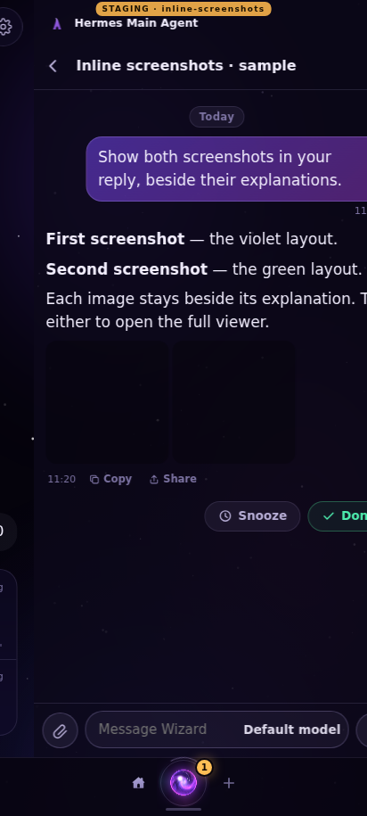
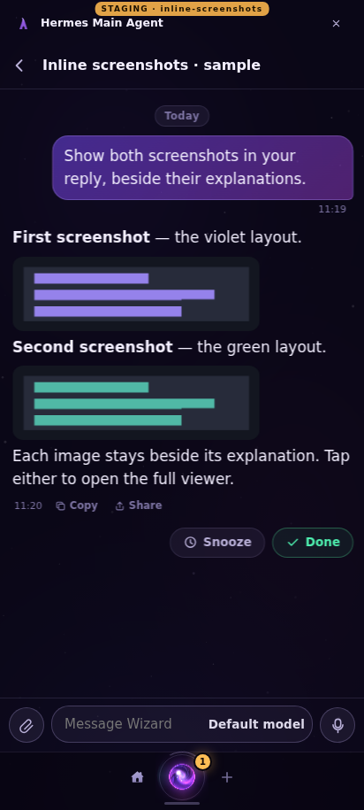
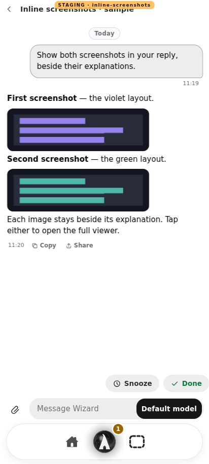
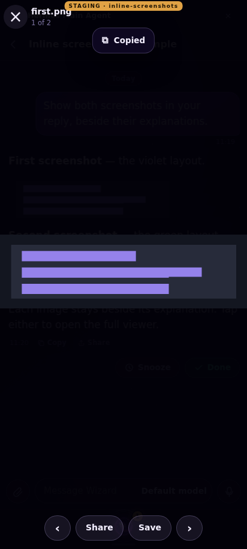

# Inline agent screenshots

Agent replies still use `MEDIA:/absolute/path` on its own line. The paired Agent Service branch resolves the file through the existing permitted roots and artifact registration, then replaces each valid MEDIA line **at that position** with its existing `helm_attachments` envelope. Image envelopes have the optional `inline: true` field. File envelopes remain `inline: false`. Raw paths never become browser image URLs. Images still use `/wizard/attachments/<id>` and the existing permission checks.

`WosChat.helm` retains validated image-envelope positions as internal Markdown image blocks. `md(text, renderMedia)` delegates only registered private attachment URLs to Chats' existing `mediaBlock` / `mediaBtn`. The same tap opens the same full-screen gallery; placed IDs are excluded from the final attachment strip. Copy and share use `plainText`, the explanation without generated attachment URLs.

Compatibility:
- Old envelopes without `inline` remain bottom attachments.
- Old clients strip the optional field and collect the same envelopes as bottom attachments, once each.
- Every MEDIA envelope retains source order, including non-images, preserving legacy cap priority.
- Missing/disallowed files keep the existing unavailable-file message. No new roots, arbitrary remote images or HTML are allowed.
- Duplicate IDs use their first validated metadata; at most 16 registered attachments are retained per parsed reply.

## Read-only review

Private preview: use the current paired pull requests' staging link (`PREVIEW_URL` when running the browser check).

This is a **sample reply**, not James's chat history. `tools/inline-images-preview.mjs` runs the paired service against a synthetic upstream, an explicit disposable state folder and two generated PNG illustrations. The outer origin rejects all non-GET/HEAD requests. It cannot send messages, forward writes to live Wizard, or use owner credentials. The staging banner is injected by the existing private staging router. No live release or merge is authorized.

To reproduce locally, install the paired Agent Service dependencies and set `PREVIEW_SERVICE` (service checkout), `PREVIEW_STATE` (disposable folder), `PREVIEW_WEB` (optional shell web folder), and `PORT`. Run `node tools/inline-images-preview.mjs`. For browser evidence, set `PREVIEW_URL`, `OUT`, `PLAYWRIGHT_MODULE` if needed, and optionally `LEGACY_WEB` pointing to the base checkout's web folder, then run `node qa-inline-agent-screenshots.cjs`.

## Verified

- `node --test tests/*.test.mjs`: 1,234 passed, zero failed.
- Paired service: `vitest run tests/agent-media.test.ts tests/media-agent-root.test.ts tests/agents.test.ts tests/markdown-hint.test.ts`: 58 passed.
- Phone Chromium on Forum, 412 × 915, Nebula and Light: correct text/image/text/image/text order; exactly two loaded thumbnails; both open the gallery; Back returns to the same thread; copy/share contain the explanation, not private image URLs; no browser exceptions; no horizontal overflow.
- An actual base-version chat renderer shows the new envelopes at the bottom without duplicates. The current renderer also keeps old message envelopes at the bottom.
- POST, PUT and DELETE return 403 at the exact HTTPS preview origin.

The regression test is named **“agent screenshots appear inline where the reply mentions them”** in both repositories.

## Phone evidence (sample data only)

| Previous renderer | Inline (Wizard / Nebula) | Inline (Mizel / Light) |
|---|---|---|
|  |  |  |

