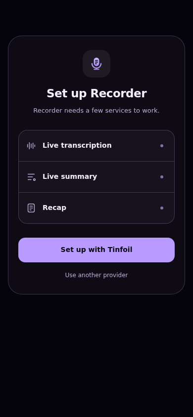
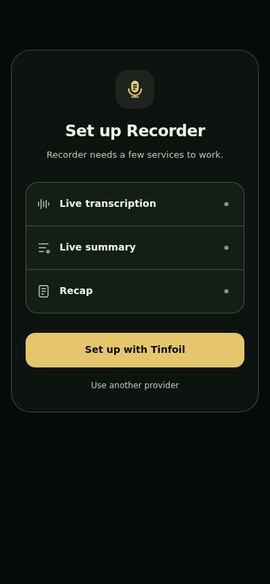
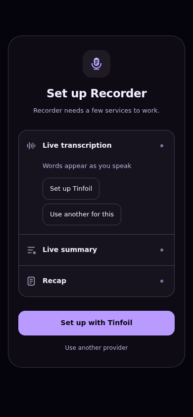
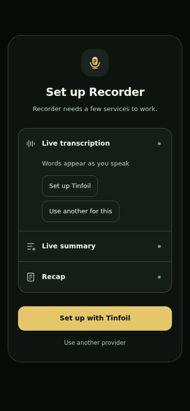
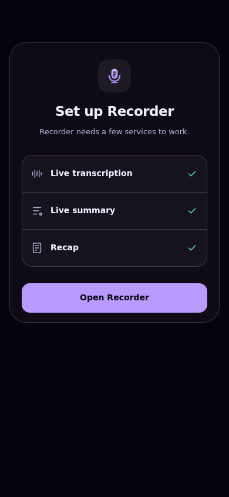
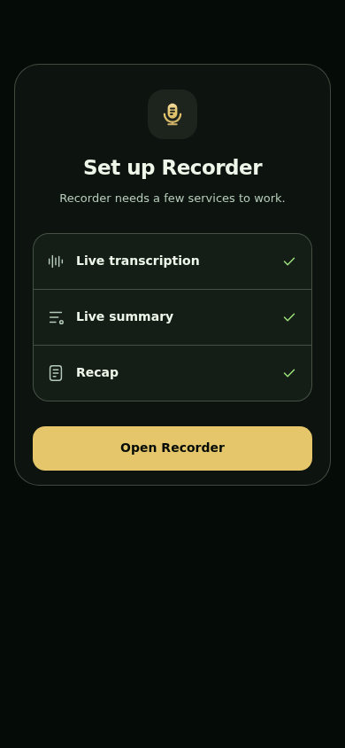
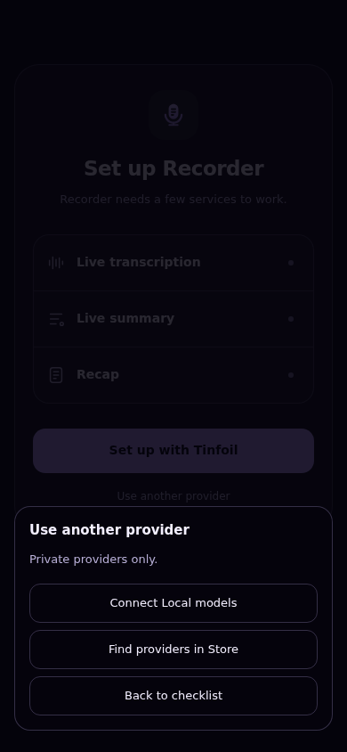
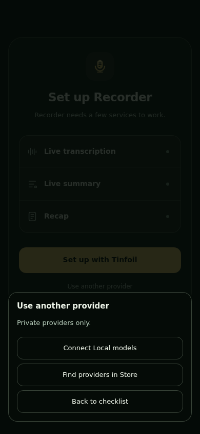
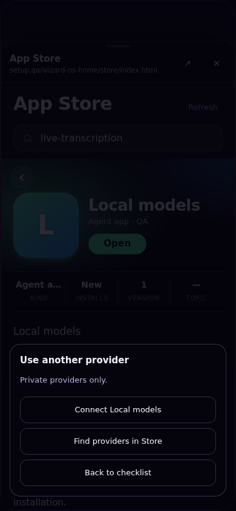
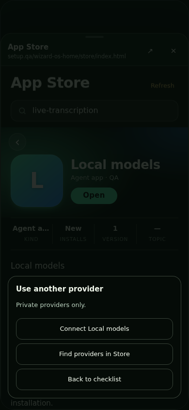

# Shared app setup — verification

## Shipped surface

`WosAppSetup` (`web/core/app-setup.js` + `app-setup.css`) renders one compact Connection Router checklist, reused by the Store install sheet and each app's **Models and connections** section.

- App sigil, **Set up Recorder**, and one subtitle.
- One disclosure per need: icon, human name, optional label if applicable, and a green check or quiet dot. Purpose, model details and named approval/connection actions appear only when expanded.
- One primary **Set up with Tinfoil** action plus a quiet **Use another provider** link. Registry display names replace app identifiers. Different recommendations use the first required recommendation in display order.
- Ready and optional-only gaps show **Open Recorder**, with no reminder to complete optional needs.
- The provider picker is a nested sheet. Back peels it, an expanded row, or a provider page before leaving the checklist. Neither shell exits or launches a blocked app on Back.
- Failures use a short status line; no per-row warning paragraphs or status badges.

The gate stays at the start of `openApp` in both `web/app.js` and `web/desktop/desktop.js`, before window creation/focus. Launcher taps, `WizOpenApp`, trusted Store opens and `?open=<id>` converge there. The continuation carries a one-call `setupChecked` flag, never a persisted readiness bypass. Cancellation and superseding launches invalidate pending reads.

Provider-page return, window focus, document visibility return, and approval re-read owner needs. Router 404/501/network errors retain the existing fail-open compatibility behavior and five-second read timeout. Required needs cannot be bypassed.

Recommended missing providers reuse `installRelease`: exact source/repo/commit/operation, polling and selection verification. Installed signed-out providers go directly to their connect page without reinstalling. The gate verifies the registered release after installation. Private-data rules and strict model policies stay Router-owned; swaps require explicit named approval. Alternatives open their own connect page, not the recommended provider's fix URL. No service-selection API is invented.

`WosAppRoute` retains private-agent setup outside this minimal sheet. `WizLinks` hosts connect pages and the slot-filtered Store. Only the exact nested Store frame may send hosted open requests. Registered provider pages receive the current `WizAppearance` skin.

## REUSE / EXTEND / NEW

- REUSE `routerNeeds` / `routerApprove`, named model approvals, `installRelease`, `WosAppRoute`, `WizLinks`, and `WizSigil`.
- EXTEND the existing `serviceRow` / model row renderer in `store-router.js` into native compact disclosures; all three surfaces use the same markup and shared `app-setup.css`, not separate Store styling.
- EXTEND `WosAppSetup` with shared primary controls, registry display names, a nested provider sheet, and disclosure-aware Back/focus handling.
- EXTEND `WizAppearance` frame discovery for registered same-origin apps in shared link sheets; origin/path checks remain enforced.
- NEW `WosAppSetup` is the original PR's per-app admission capability in `web/core`, registered in COMPONENTS.md and the responsive inventory. This redesign adds no parallel module.

## Current-main integration

The current candidate keeps main's Store sharing/source labels and shell navigation. Nested app links now use the same admission check as launcher opens on both shells; `tests/app-setup-link-admission.test.mjs` exercises the actual entry functions and preserves the deep path. The previously live-only Opening… settlement callback is included so the opening notice ends when the check does.

Focused setup/link tests: 16 passed. The component inventory tests pass without raising their existing size ceiling. Full CI and a fresh disposable-worker browser pass must verify this candidate; the screenshots and counts below describe the earlier checklist revision, not new evidence for the integration.

## Previous checklist evidence

- `npm test`: **761 passed**, zero failed/skipped, including **14 setup unit tests**.
- `QA_OUT=<evidence-dir> node tests/qa-app-setup.cjs`: **132 browser checks passed**. Real phone/desktop entrypoints in Nebula and Grove, 390 × 844 / 1280 × 844; shared Store rows, hidden advanced copy, one visible primary, expanded-row Back, provider-sheet Back, qualified install → connect, installed signed-out connect without reinstall, ready/optional/private states, nested Store filtering and Appearance, focus/visibility/provider-return rechecks, compatibility fallback, and zero page errors.
- `node tests/qa-store-router.cjs`: **70 passed**, zero failed. Model match/missing/swap at 390 / 1280px, collapsed disclosures, exact named approval and qualified Store installation.
- `git diff --check`: clean.

Recorder fixtures are captured owner-needs responses from the integration run (`tests/fixtures/recorder-needs-before.json` and `recorder-needs-ready.json`). Synthetic variants cover optional/private/failure paths. Browser API calls remain isolated fixtures; these are actual Chromium screenshots, not a claim of live provider acceptance. No credentials or recording content are included.

## Reviewed phone screenshots (390 × 844)

| State | Nebula | Grove |
| --- | --- | --- |
| Required, not ready |  |  |
| Expanded row |  |  |
| Ready |  |  |
| Use another provider |  |  |
| Slot-filtered nested Store |  |  |

Required, expanded and ready screenshots were visually reviewed in both skins, along with desktop, reused Store rows and provider picker. The runner accepts `QA_OUT` for further evidence. The standalone Store retains its dark fallback; hosted Store skin adoption is verified in both skins.

No merge, live deployment, or owner-install mutation is part of this PR.
