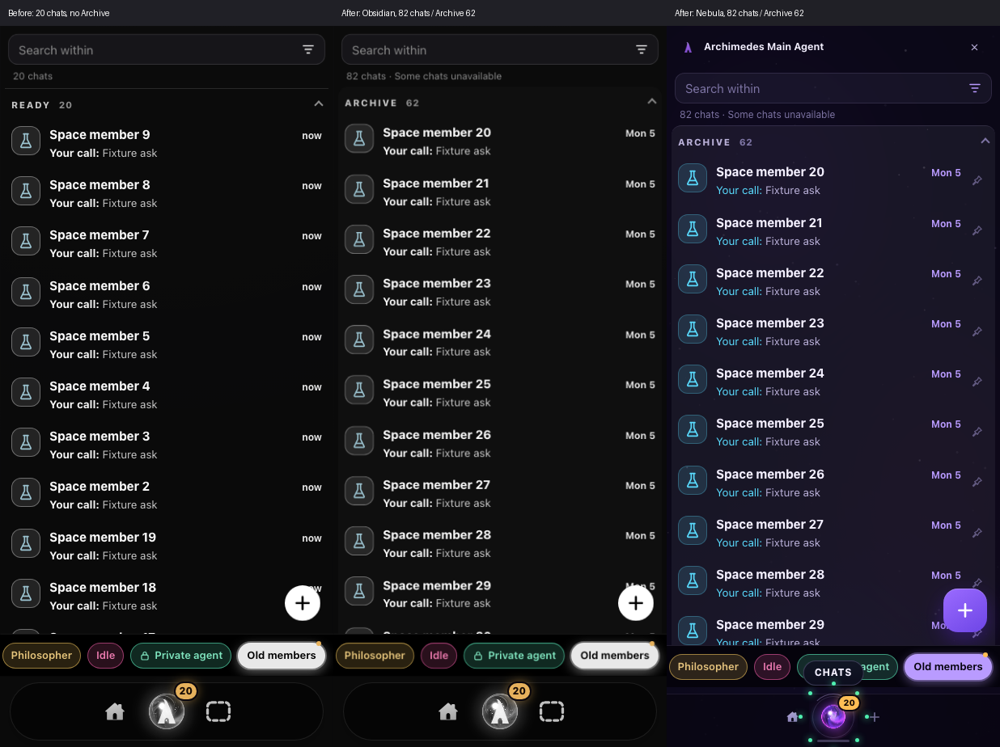
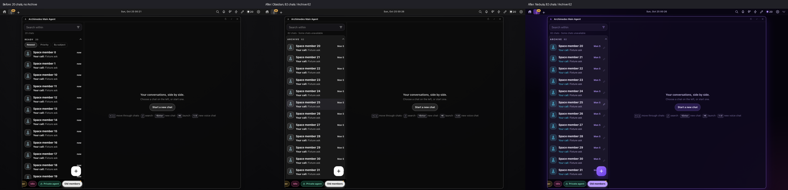

# Focused Space membership: archive-window regression

Synthetic fixtures only; no production threads or preferences were changed.

## Design

`WizLive.spaceSessions(ids)` reads missing explicit Space members through the existing
allowed `GET /api/sessions/<id>?view=detail` route. Reads share a four-request queue,
stop admitting work while the document is hidden, and cache successes for the existing
three-minute full-walk cadence (failures for one minute). Rows remain in memory and
are used only by the focused Space; All/agent Focus and their archive cursors are unchanged.
Identity/scope checks and hidden/private discovery exclusions remain enforced. No lifecycle
state is fabricated and no oversized list-overrides payload is needed.

## Verified

- `npm test`: **761 passed, 0 failed** on Telos.
- `node --test tests/space-members.test.mjs`: seven behavioral tests cover 82 members /
  62 archived beyond the global window; 500-member capacity; main, host-profile,
  container and restricted routing; scope races; hidden/private discovery; negative
  caching; hidden-tab pause/resume; changed membership; and stale-row removal.
- On Thales, with a local read-only QA origin:
  `QA_SPACE_MEMBERS_ONLY=1 node qa-chats-focus.cjs "$QA_ORIGIN"`
  - Baseline `fc6bea34965fcb9a884cf4b7b312042b0c585b22`: **1 passed, 4 failed**.
    Phone and desktop each showed only **20 chats**, with Archive missing.
  - Candidate: **15 passed, 0 failed**. Both shells show **82 chats / Archive 62**,
    expose all 62 old rows through existing display pagination, exclude hidden/private
    discovery, leave All windowed, and return from an old member to the same Space.
  - Screenshots reviewed in Obsidian and Nebula; no layout/style implementation changed.
  - The fixture deliberately also includes hidden, private-discovery and deleted IDs;
    the resulting “Some chats unavailable” message is expected, not a missing visible member.

The canonical parity inventory update is documentation-only:
[Wizard Agent Service #160](https://github.com/humanitylabs-org/wizard-agent-service/pull/160).
These fixture/browser results are not live runtime proof. No deployment or Android build.

## Before / after

